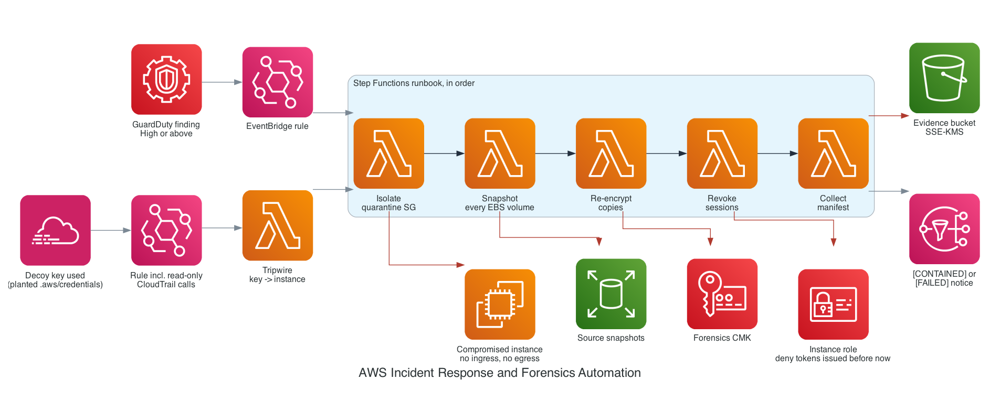

# AWS Incident Response and Forensics Automation

A GuardDuty finding against an EC2 instance, or any use of a decoy access key
planted on it, triggers a Step Functions runbook
that contains the host, captures evidence, and revokes leaked credentials
without a human in the hot path. The steps run in the order an incident
responder would run them by hand, encoded as state so they run the same way
every time and leave an auditable trail.



The runbook reads left to right in execution order, and each step's effect sits
beneath it. Containment comes first: the instance loses all network access
before anything else runs. Every terminal path ends in an SNS notice, so a
failure is never silent.

## Landing zone mode

`terraform/lz` runs this runbook as a standing control in the security account of the
[aws-landing-zone](https://github.com/jordann6/aws-landing-zone) organization instead of a
standalone demo. Each Step Functions step gets its own narrow role in the target account
(`/forensics/` path), GuardDuty findings reach the runbook over a cross-account bus, and
the evidence bucket and KMS key live in the security account.

Proven live on 2026-10-06 in the landing zone: a sample GuardDuty finding started an
execution, and a drill isolated a prod instance (quarantine security group, tags, a
session-revocation deny keyed to the token issue time), copied an encrypted snapshot under
the evidence key, wrote a manifest, and deleted its own source snapshot.

## What the live drill found

**The encrypt step ran before the snapshot existed.** `CopySnapshot` rejects a
source that is still pending, and the first live drill failed with "Source
snapshot is not complete". No test had covered snapshot timing, because
nothing waits on a pending snapshot until a real one exists. The encrypt step now raises
`SnapshotNotReady` while any source is pending, and the state machine retries
it every 20 seconds, up to 45 attempts, and
`test_encrypt_waits_for_incomplete_source` guards the behaviour.

The ordering paid off here: the first run had already contained the instance,
so only evidence capture failed. Had capture run first, the host would have
stayed online while the runbook errored.

## Cost and teardown risk, up front

Built to deploy, demo, and destroy. Everything is serverless or tiny:

- Step Functions, Lambda, EventBridge, SNS: effectively free at demo volume.
- GuardDuty: free 30-day trial on a new detector; set `create_guardduty_detector = false` if the account already has one enabled.
- One `t3.micro` demo victim and a couple of 8 GiB snapshots: a few cents.
- The forensics KMS key: $1/month prorated, plus a 7-day deletion window on destroy (unbilled while pending).

Rough cost for a deploy-demo-destroy session: under a quarter. Two things
outlive `terraform destroy`. The KMS key sits in its 7-day pending deletion
window, which is free. The encrypted evidence snapshot the runbook made is not
in Terraform state, so delete it by hand (see Destroy).

## Why this order

Isolation runs **before** evidence capture on purpose. A live attacker on the
box is doing damage every second; cutting network access the instant a
high-severity finding lands outranks the few seconds of forensic completeness
lost by not snapshotting first. Volatile state (running processes, memory, open
sockets) survives an SG swap, so nothing is lost by containing first anyway.
Credential revocation runs after evidence capture because it mutates the
instance role, and we want the role state recorded before we change it.

## What the runbook does

1. **ExtractContext** parses the finding, resolves the instance, and decides
   whether to act (severity gate). Real `aws.guardduty` findings and synthetic
   `forensics.demo` findings are handled identically.
2. **IsolateInstance** swaps every ENI on the instance to a quarantine security
   group with no ingress and no egress, then tags the instance as under
   investigation. The host is cut off in both directions but left running.
3. **SnapshotEvidence** snapshots every attached EBS volume. These source
   snapshots inherit the volume's encryption state (often none).
4. **EncryptSnapshots** copies each source snapshot re-encrypted with a
   dedicated forensics KMS CMK, moving evidence into a custody domain governed
   by a key only the pipeline and account admins control. A bounded wait loop
   (`WaitForSnapshots` / `CheckSnapshots`) polls the copies to completion.
5. **RevokeCredentials** attaches a deny-all policy conditioned on
   `aws:TokenIssueTime` to the instance role, invalidating every temporary
   credential issued before now. This kills any STS session an attacker
   exfiltrated from the metadata service, which isolating the host does not do.
6. **CollectEvidence** writes a JSON manifest (finding, containment actions,
   evidence snapshot ids, captured console output) to an SSE-KMS S3 bucket,
   then deletes the unencrypted source snapshots so only encrypted evidence
   survives.

Every terminal path publishes to SNS: a `[CONTAINED]` summary on success or a
`[FAILED]` notice with the full execution state on error.

## Decoy credential tripwire

GuardDuty tells you about behavior it recognizes. A decoy key tells you the
moment someone reads a file they should never have seen. `terraform/decoy.tf`
plants a real access key, on an IAM user with zero policies, in
`.aws/credentials` on the victim. Nothing legitimate ever uses it, so any API
call signed with it means the box is compromised.

The path is CloudTrail, then an EventBridge rule matching that one access key
id, then `app/decoy_tripwire.py`. The tripwire looks up which instance the key
was planted on (an SSM parameter keyed by access key id), sends a
`[DECOY KEY USED]` alert, and starts this same runbook with a GuardDuty-shaped
finding. The instance gets isolated, snapshotted, and its role sessions revoked
exactly as if GuardDuty had fired.

Decisions that matter:

- **One key per server.** The alert can only name the box to isolate because
  each key maps to exactly one instance. A shared decoy key would tell you
  something was compromised and nothing about where.
- **A believable name.** AccessDenied errors and `sts:GetCallerIdentity` echo the
  user ARN back to the caller. A user called `decoy` or `honeytoken` tells the
  attacker it is a trap, so the default is `svc-prod-backup`.
- **The rule state is `ENABLED_WITH_ALL_CLOUDTRAIL_MANAGEMENT_EVENTS`.** An
  attacker's first call is usually `GetCallerIdentity` or a `List`, and a rule
  in the plain `ENABLED` state never sees read-only calls.
- **Isolate the server, not the account.** The key cannot do anything, so
  disabling it protects nothing. The damage is on the host it was stolen from.
- **One execution per instance per day.** Attackers make calls in bursts. The
  execution name is `decoy-<instance>-<UTC day>`, so the first call starts the
  runbook and the rest are no-ops instead of a pile of duplicate snapshots.

Proven live on 2026-11-18 in standalone mode. `trip_decoy.sh` called
`sts get-caller-identity` (succeeded, echoing `user/svc-prod-backup`) and
`s3 ls` (AccessDenied) with the decoy key. The runbook started 4 seconds after
the first call and finished containment at 155 seconds. The second call was
logged as a duplicate, so one burst produced one execution. `validate.sh`
passed all eight checks, including that the decoy user still has zero
policies. Destroyed the same session: 69 resources, plus the one evidence
snapshot by hand.

Deploying it found three bugs, none of them in the decoy code:

- **No default subnets.** The landing zone deletes the default VPC's subnets,
  so `data.aws_subnets.default.ids[0]` failed on an empty list. The fix creates
  one throwaway victim subnet when none exist.
- **The fix fought itself.** On the next plan the subnet lookup found the new
  demo subnet, the count flipped to 0, and Terraform planned to destroy it.
  Filtering on `default-for-az` keeps the lookup to real default subnets.
- **Step Functions refused the state machine:** "The state machine IAM Role is
  not authorized to access the Log Destination." The runbook module turns on
  logging and X-Ray tracing, and only the landing zone role granted them. The
  standalone role now does too.

Limits, stated plainly:

- **A tripwire, not a lock.** It detects, it does not protect a real key
  sitting next to it. The decoy should be the only static key on the box; real
  access comes from the instance role, whose sessions the runbook revokes the
  moment the decoy fires. An attacker who uses a real key before testing the
  decoy gets a head start, which is one more reason not to keep real keys on
  servers.
- **Fast, not instant.** The live run below started the runbook 4 seconds
  after the first decoy call. EventBridge gets CloudTrail events on its own
  path; the minutes-long delay people quote is for log files landing in S3.
  `scripts/trip_decoy.sh` measures it every run.
- **Needs a trail.** CloudTrail events reach EventBridge only if a trail is
  logging management events (read and write) in the account.
- **One region in standalone mode.** The rule lives in the deploy region, and the
  planted config sets that region. A caller who passes another `--region`
  lands in that region's EventBridge. Covering every region means a forwarding
  rule per region to the home bus, which belongs in the landing zone.
- **Can be fingerprinted.** `sts:GetAccessKeyInfo` returns the account id for
  a key and is logged in the caller's account, not this one. A careful
  attacker can learn which account a key belongs to without tripping anything.
- **The secret is in Terraform state and instance user data.** Both are already
  sensitive, and the key can only raise the alarm.

## Containment boundary

The one destructive capability in the pipeline, credential revocation, is
fenced two ways that agree:

- The `revoke_credentials` Lambda's IAM policy only allows `iam:PutRolePolicy`
  on roles under the `/forensics-demo/` path.
- The function re-checks the role's path at runtime before mutating it.

So even a bug in the function cannot attach a deny policy to an arbitrary role.
In a real deployment you widen the path to the paths your workloads actually
use, deliberately, rather than granting `iam:PutRolePolicy` on `*`.

## Least privilege

Each of the eight Lambdas (seven runbook steps plus the decoy tripwire) has its own execution role with only that step's
permissions. The snapshot function cannot touch KMS; the revocation function
cannot read S3; the evidence collector can delete only snapshots tagged
`forensics:stage=source`. A compromise of any single function is contained to
that function's slice.

## DevSecOps pipeline

GitHub Actions gates every push and PR (`.github/workflows/ci.yml`):

- **ruff** lints the Lambda source.
- **bandit** runs Python SAST, blocking on medium severity and up.
- **terraform fmt + validate** enforce formatting and correctness.
- **checkov** scans the Terraform for HIGH/CRITICAL misconfigurations.
- **gitleaks** blocks committed secrets.

## Deploy

```sh
cd terraform
cp backend.hcl.example backend.hcl   # fill in your state bucket
terraform init -backend-config=backend.hcl
terraform apply -var="alert_email=you@example.com"
```

Confirm the SNS subscription email so notifications arrive. GuardDuty takes a
few minutes to become active on a fresh detector; the synthetic demo finding
does not depend on it.

## Demo

```sh
scripts/demo.sh          # injects a synthetic High finding for the victim
scripts/trip_decoy.sh    # or: use the planted decoy key like an attacker would
scripts/validate.sh      # asserts the outcomes below
```

`validate.sh` confirms: the execution succeeded, the instance is on the
quarantine SG and tagged, an encrypted evidence snapshot exists, the
unencrypted source snapshots were cleaned up, the instance role carries the
revocation policy, an evidence manifest landed in S3, and the decoy user still
has zero policies.

`trip_decoy.sh` calls `sts get-caller-identity` and `s3 ls` with the decoy
key, then prints how many seconds passed before the runbook started and
before it finished.

## Destroy

```sh
cd terraform
terraform destroy -var="alert_email=you@example.com"
```

Then delete the evidence snapshots the runbook created, which Terraform never
owned:

```sh
aws ec2 describe-snapshots --owner-ids self \
  --filters Name=tag:forensics:stage,Values=evidence \
  --query 'Snapshots[].SnapshotId' --output text \
  | xargs -n1 aws ec2 delete-snapshot --snapshot-id
```

`force_destroy` is set on the evidence bucket so teardown is clean. The KMS key
enters a 7-day deletion window (free). A production build would instead keep
evidence in an Object Lock bucket in a separate security account with a
lifecycle to Glacier, which is a retention choice, not a technical limit.

## Production notes

- Evidence would live in a dedicated security/log-archive account, not the
  workload account, so a compromise of the workload account cannot reach it.
- The evidence bucket would use Object Lock in compliance mode for legal hold.
- Snapshots would be shared to the forensics account and analyzed from a
  clean-room investigation instance rather than kept in place.
- The revocation path would widen from `/forensics-demo/` to the real workload
  role paths, reviewed deliberately.
